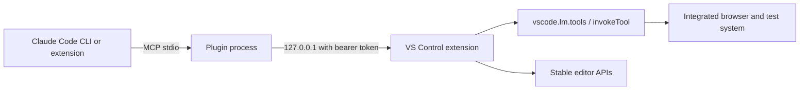

# VS Control

Give Claude Code control of VS Code's browser, tests, and editor.

VS Control connects Claude Code to VS Code's integrated browser, native test tools, and editor APIs over MCP. It works with both the CLI and Anthropic's Claude Code extension. Install **both components**: the Claude Code plugin and the **VS Control — Claude Code Bridge** extension.

The bridge uses the public `vscode.lm.tools` and `vscode.lm.invokeTool` APIs recommended by the VS Code team for this use case. It requires no VS Code patches, fabricated chat sessions, or CDP connection. See [Microsoft issue #322883](https://github.com/microsoft/vscode/issues/322883), and [the VS Code team's recommendation in issue #5](https://github.com/thimo/vscode-integrated-browser-mcp/issues/5).

## Installation

Requirements: VS Code Desktop 1.109 or later, preferably a recent version with integrated browser tools; Claude Code with plugin support; and **Node.js 20 or later on the Claude process's PATH**. Running tests requires a test extension that discovers your project's tests in VS Code. Available tools depend on your VS Code version, settings, and installed extensions.

When starting from a source checkout, run `npm run package` to create the installation files. Published builds will be available on the [GitHub releases page](https://github.com/morzan1001/VS-Control/releases). This requires Node.js and Python 3; no npm dependencies need to be installed. See [Development](#development) for details.

1. Install `dist/vs-control-bridge-0.0.1.vsix` using **Extensions: Install from VSIX…** in VS Code. Open your project as a trusted workspace and reload the window if needed. **VS Control** appears in the status bar.
2. Add the GitHub repository as a plugin marketplace in Claude Code:

   ```text
   /plugin marketplace add morzan1001/VS-Control
   /plugin install vs-control@vs-control
   ```

   For local development before publishing the repository, use `/plugin marketplace add /absolute/path/to/VS-Control` instead. Alternatively, extract `dist/vs-control-plugin-0.0.1.zip` and use the extracted marketplace folder, including its hidden `.claude-plugin` directory. The Claude Code extension also supports plugin management; see [Anthropic's VS Code documentation](https://code.claude.com/docs/en/vs-code#manage-plugins).
3. Start a **new Claude Code conversation**, enable MCP when prompted, and run `/vs-control:doctor` to check the connection and available tools. In VS Code, **VS Control: Show Connection and Tools** displays the other side of the connection.

For a CLI trial without installing from a marketplace:

```sh
claude --plugin-dir /absolute/path/to/VS-Control/plugin
```

`--plugin-dir` applies to that CLI process. Use the marketplace installation for persistent loading in the Claude Code panel. Repository scripts do not automatically install into your regular VS Code or Claude profile.

If `node` is unavailable, macOS users can use VS Code's bundled runtime for development:

```sh
ELECTRON_RUN_AS_NODE=1 '/Applications/Visual Studio Code.app/Contents/MacOS/Code' scripts/build.cjs
```

The standard plugin configuration still requires Node.js on PATH. To generate a machine-specific plugin using VS Code's bundled runtime instead:

```sh
ELECTRON_RUN_AS_NODE=1 '/Applications/Visual Studio Code.app/Contents/MacOS/Code' scripts/prepare-local.cjs
```

Then add `/absolute/path/to/VS-Control/dist/local-marketplace` in Claude Code and install `vs-control@vs-control-machine`. Use either this local variant or the portable plugin, not both. Regenerate the local variant if the runtime moves. It stays in the ignored `dist/` directory.

## Capabilities

| Area | Implementation |
| --- | --- |
| Integrated browser | Forward available native tools for opening pages, navigation, page reading, screenshots, clicks, typing, hovering, dragging, dialogs, and Playwright; list pages when supported |
| Tests | Use native `runTests`, `testFailure`, and available coverage tools with their actual schemas and results |
| Test Explorer | Open the test view, refresh tests, run all tests, rerun failures, or cancel a run; command dispatch is not a test result |
| Editor | Read the active file, selection, open tabs, unsaved state, and Problems diagnostics; open files |
| Code navigation | Request document symbols, definitions, and references through installed language providers |
| Tasks | List and run configured tasks; inspect execution status and exit codes |
| Debugger | List and start named launch configurations; stop the active session |
| Additional native tools | Optionally enable terminal, notebook, and code groups, or explicitly allow individual tool IDs |

The skill, tool descriptions, and `SessionStart` hook encourage Claude to inspect capabilities and prefer the integrated browser or native test tools for relevant work. They **cannot guarantee a model's tool choice**. The hook supplies context without performing IDE actions or approving tools automatically.

Example prompts:

```text
Inspect the failing tests in VS Code's Test Explorer, fix the cause,
and rerun the affected tests.

Open our running app at http://localhost:3000 in the integrated browser.
Create an item and check that it persists after reloading the page.

Read the active file's diagnostics and show me the symbol's definition.
```

## Settings and limitations

By default, the bridge exposes browser and testing tools alongside its own editor helpers. It discovers native tools from VS Code at runtime. `vscode_tools` also shows disabled native tools and their input schemas. Changes are announced through MCP's `notifications/tools/list_changed`. Some native tools appear shortly after startup.

Enable additional groups in your **user settings**:

```json
{
  "vsControl.nativeToolGroups": ["browser", "testing", "terminal", "notebook", "code"],
  "vsControl.additionalToolNames": [],
  "vsControl.additionalCommands": [],
  "vsControl.toolTimeoutSeconds": 120
}
```

Groups contain known exact tool IDs. Review new or differently named tools before adding them to `additionalToolNames`. MCP tools are excluded to prevent forwarding loops. `additionalCommands` expands the callable VS Code commands and should be configured deliberately.

- **Browser:** Enable `workbench.browser.enableChatTools`. Existing tabs remain subject to VS Code's **Share with Agent** controls and native confirmations. Multiple Claude sessions in one window do not receive separate native chat tokens; the bridge does not reproduce Copilot's chat-session isolation.
- **Tests:** The bridge does not use experimental APIs to read other extensions' test trees. When native test tools are unavailable, UI commands remain available without fabricated pass/fail results. A test adapter is still required.
- **Terminal and debugger:** Task helpers do not read arbitrary terminal history. Debug helpers do not inspect variables or stack frames. Available native tools may provide additional functionality.
- **Results:** Text and `LanguageModelDataPart` images become MCP content. Unsupported formats such as Prompt-TSX return an explicit error with raw data. The public VS Code API does not expose every internal error field, so native result text must also be inspected.
- **Remote:** The workspace extension and MCP process must run on the same host as the same user, such as both inside a container or both on an SSH host. VS Code Web without a Node extension host is unsupported. Windows and remote environments have not been tested here.
- **Multiple windows:** Discovery selects the most specific matching workspace path. Equal matches require `vscode_select_window`. After the first IDE call, the connection stays bound to that window. Use `vscode_windows` to select it again after a restart. Git worktrees outside the open workspace are not matched automatically.
- **Copilot:** The plugin forwards available tools. It does not provide Copilot cloud features, model subscriptions, inline completions, or the full chat interface. Some tools may require authentication or chat-session context.

## Local connection



Each window uses a random port and token. Connection descriptors live outside the repository in `~/.vs-control/instances`, with POSIX permissions of `0700` for the directory and `0600` for files. The server binds only to `127.0.0.1`, checks the host, origin, token, and workspace trust, limits message sizes, and supports cancellation and deadlines. Windows uses inherited user-profile permissions. The bridge does not protect against other processes running as the same user; installed extensions are also part of the trust boundary. VS Control does not log tool arguments, tokens, or results, and sends no telemetry.

## Development

No npm dependencies or startup downloads are required:

```sh
npm run verify
npm run test:integration
claude plugin validate ./plugin
```

`verify` checks versions and syntax, runs tests, builds packages, verifies checksums and reproducibility, and starts the extracted MCP server. `build` refreshes generated extension files from source. `test:integration` requires VS Code Desktop; set `VSCODE_EXECUTABLE` to override its location. It launches a temporary profile with two development extensions. The workspace-trust prompt is disabled only for that test window. It leaves the regular user workspace untouched and does not globally disable native tool confirmations.

`package` also requires Python 3 and creates the VSIX and standalone marketplace ZIP in `dist/`. Both archives use fixed timestamps and file modes. `SHA256SUMS-0.0.1.txt` records their hashes. The VSIX is built directly as a standard ZIP package. A marketplace publisher account is not required for local installation; use your own publisher identity when publishing.

Unit and transport tests cover authentication, origin and host checks, window selection, cancellation, deadlines, schema forwarding, image results, and MCP errors. The extension-host test writes `dist/vscode-integration-report.json`. The original local run passed 26 unit/protocol/transport tests and 12 extension-host checks on macOS with VS Code 1.146.0. A model-driven Claude panel conversation, Windows, and remote environments have not been verified.

Responses are limited to 16 MiB; larger results return an explicit error rather than truncated JSON. Tool-group and additional-ID changes take effect immediately. Set `VS_CONTROL_STATE_DIR` on both sides for isolated testing, or `VS_CONTROL_WINDOW_ID` to select a specific descriptor. The bridge is intended for local connections.

The **Tests** GitHub Actions workflow runs on pushes to `main`, version tags, pull requests, or manual dispatch. It checks Linux and macOS with Node.js 20 and 24, covering syntax, versions, unit/protocol/transport tests, package contents, checksums, reproducibility, and extracted MCP startup. The interactive VS Code extension-host suite is a separate local check. Hosted runs start only after the repository is uploaded.

`dist/` contains generated files and `docs/` holds optional local notes. Neither directory is tracked or required by a fresh checkout; release archives exclude local notes as well. Release notes are generated from the current version's [CHANGELOG.md](CHANGELOG.md) section. See [CONTRIBUTING.md](CONTRIBUTING.md) for repository conventions and the release sequence.
